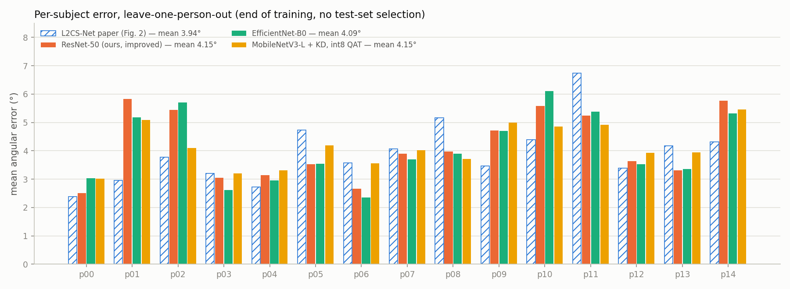
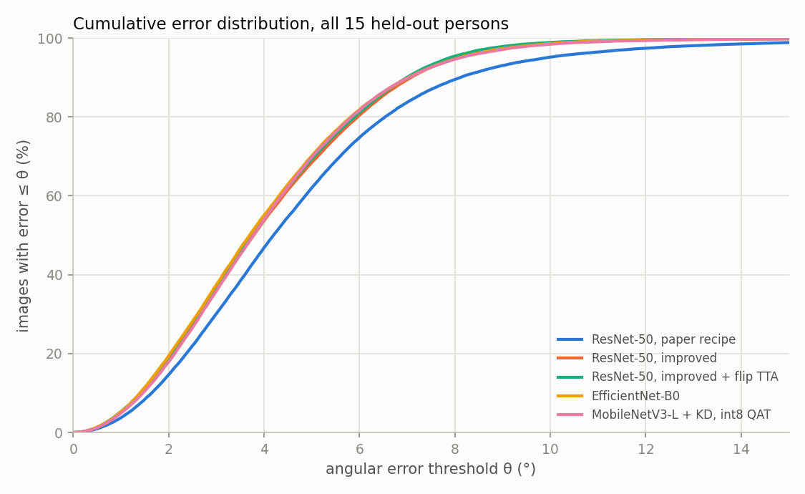
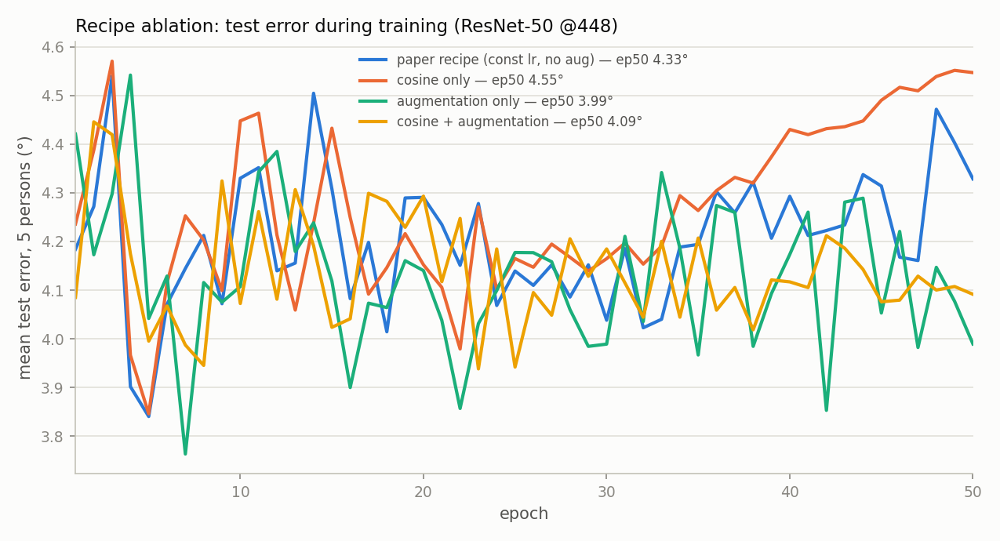

# L2CS-Net 視線估計在 MPIIFaceGaze 上的重現、改良與車用輕量化 — 完整實驗結果

> 所有數字皆由 `scripts/make_final_report.py` 從逐張預測檔（每個測試影像一列）計算，表格原檔在 `results/final/tables.md`，
> 逐人數字在 `per_person.csv`，所有指標在 `summary.json`。訓練與評估都在 NCHC Nano4（H200）上執行，job ID 見第 8 節。跨資料集（Gaze360、RT-GENE）的結果在第 5 節，紀錄在 `results/crossdata/`。

## 摘要

我們在 MPIIFaceGaze 上以 leave-one-person-out（15 fold）重現 L2CS-Net。結果如下：

- **論文配方的誠實數字是 4.70°。** 誠實數字指最後一個 epoch、不看測試集挑選，論文報告為 3.92°。論文配方明顯過擬合；若在每個測試者身上挑最佳 epoch，可以得到 3.53°，但這個數字偏樂觀。
- **加入資料增強與 cosine 學習率衰減後降到 4.15°**（p = 0.017）。消融實驗顯示，改善主要來自資料增強；只用 cosine 反而變差。
- **輕量化方面，MobileNetV3-Large 加上以 ResNet-50 為老師的知識蒸餾（KD），得到 4.01°（fp32）。** 運算量只有 ResNet-50 的 1/19（0.85 vs 16.35 GMACs）。
- **經 int8 量化感知訓練（QAT）後為 4.15°，與 ResNet-50 fp32 完全持平**（成對 t 檢定 p = 0.98）。它在 2 TOPS 等級的車用 NPU 上理論可達 25 fps 以上。
- **EfficientNet-B0 的 fp32 精度一樣好（4.09°），但 int8 量化後崩到 7.70°，QAT 也只回到 4.6–5.0°。** 因此只比較 fp32 會選錯部署模型。
- **Gaze360 上重新訓練 L2CS-Net 得到 11.04°（論文 10.41°；官方權重經我們的前處理為 10.56°）。** 跨資料集時誤差大幅上升：MPII 訓練的模型在 Gaze360 為 29–32°（受 ±42° 輸出範圍限制）、在 RT-GENE 為 14.4–15.2°；Gaze360 訓練的模型在 MPII 為 8.2–8.4°。
- **事先登記的「大角度資料 + 輕量化」實驗三個標準都沒有達成。** Gaze360 + MPII 聯合訓練的 MobileNetV3-L 在 Gaze360 為 11.6°、MPII 留出 5 人為 5.3°，但 RT-GENE 仍約 29°，int8 差距 0.33°。跨資料集的瓶頸在影像外觀，不在角度範圍。

## 1. 實驗設定

| 項目 | 設定 |
|---|---|
| 資料集 | MPIIFaceGaze（15 人，正規化臉部影像，使用每人**全部**標註影格：每人 1,498–2,927 張，共 37,667 張測試影像；GazeHub／論文的評估清單是每人固定 3000 筆（依眼睛樣本清單取臉，含重複），兩者不同，見第 7 節） |
| 評估協定 | Leave-one-person-out：每次留 1 人測試、14 人訓練，共 15 fold；報告 15 人平均角度誤差 ± 標準差（跨人） |
| 誠實數字 | 一律採**訓練結束時（最後一個 epoch）**的權重；「最佳 epoch」是在測試者身上挑的，只作參考並明確標註 |
| 模型 | L2CS-Net：骨幹 + 兩個 28-bin（3°／bin）分類頭，loss = CE + MSE（期望值回歸） |
| 論文配方（A） | Adam lr 1e-5 固定、batch 16、50 epoch、無增強 |
| 改良配方（B） | 同 A，加上 cosine 衰減（1e-5 → 1e-7）與資料增強（色彩抖動、平移、水平翻轉；翻轉時水平角取負） |
| 輕量化 | torchvision ImageNet 預訓練骨幹 + 相同兩個頭；改良配方、lr 1e-4、20 epoch |
| 知識蒸餾 | 老師 = 同一 fold 的 B（ep50 權重，不用測試者挑的 best）；兩頭各加 T²·KL，T = 2、權重 1 |
| 量化 | PyTorch FX、x86 後端：權重 per-channel int8、activation uint8 |
| 量化方式 | PTQ：用訓練者 256 張影像校正；QAT：從最後權重微調 2 epoch、lr 1e-5，第 2 epoch 凍結 observer 與 BN |
| 硬體 | 訓練：H200（bf16 autocast）；int8 評估在 CPU |

### 指標定義
- **平均角度誤差**：3D 視線向量夾角，先算每人平均，再對 15 人平均。這是本資料集的標準指標，可與文獻比較。
- **95% CI**：跨 15 人的 t 分布信賴區間。
- **中位數、P90、Acc@θ**：把 15 人全部測試影像合併計算（每張影像在 LOPO 中恰被測一次）。Acc@θ 是誤差 ≤ θ 的影像比例。
- **水平／垂直 MAE**：兩個角度各自的平均絕對誤差。
- **視線區域 Acc／macro-F1**（衍生指標）：MPIIFaceGaze 是回歸資料集，沒有官方分類標籤。為了提供 F1，我們把 2D 視線平面依「全資料集真值的三分位數」切成 3×3 共 9 區，門檻固定為水平 −4.70°／5.04°、垂直 −11.77°／−5.81°。預測落在哪一區、真值落在哪一區，據此算 9 類的 accuracy 與 macro-F1。這可以類比 DMS 的「注視區域」判斷，但區域邊界附近的小誤差也會被算成錯，所以數值偏嚴格。
- **統計檢定**：與參考模型在同一批測試者上做成對 t 檢定與 Wilcoxon signed-rank 檢定；「較好人數」是誤差較低的測試者數。

## 2. 主要結果

### 2.1 與文獻比較（表 1）

| 方法 | 平均誤差（度） |
|---|---|
| FullFace（Zhang et al., 2017） | 4.93 |
| RT-Gene（Fischer et al., 2018） | 4.66 |
| Dilated-Net（Chen & Shi, 2018） | 4.42 |
| CA-Net（Cheng et al., 2020） | 4.27 |
| Gaze360（Kellnhofer et al., 2019） | 4.06 |
| GazeTR-Hybrid（Cheng & Lu, 2022） | 4.00 |
| L2CS-Net（Abdelrahman et al., 2022，論文） | 3.92 |
| 本研究：ResNet-50，論文配方 | 4.70 ± 0.96 |
| 本研究：ResNet-50，論文配方，最佳 epoch（偏樂觀） | 3.53 ± 0.66 |
| 本研究：ResNet-50，改良配方 | 4.15 ± 1.17 |
| 本研究：ResNet-50，改良配方 + 翻轉 TTA | 4.10 ± 1.18 |
| 本研究：EfficientNet-B0 | 4.09 ± 1.20 |
| **本研究：MobileNetV3-L + KD** | **4.01 ± 1.04** |
| 本研究：MobileNetV3-L + KD + 翻轉 TTA | 3.97 ± 1.05 |
| **本研究：MobileNetV3-L + KD，int8 QAT（部署版）** | **4.15 ± 0.75** |

文獻數字為原論文報告值，我們沒有重跑。

- **論文配方的誠實數字（4.70°）比論文的 3.92° 差 0.78°；最佳 epoch 數字（3.53°）則比論文好。** 論文的 3.92° 很可能落在兩者之間，例如在較早的 epoch 停止。逐人曲線顯示論文配方 15 人平均誤差在第 5 epoch 最低（4.05°），到第 50 epoch 升到 4.70°，是典型過擬合。
- **可重現性檢查**：遠端 fold0 第 7 epoch 為 2.80°，本機為 2.78°，差 0.02°。論文配方的其他對照組差距也都在 ±0.1° 內，只有 p11 差 −0.32°，在該人逐 epoch 的雜訊範圍內。詳見 `results/remote/RESULTS_REMOTE.md`。

### 2.2 完整指標（表 2，15 fold，參考 = ResNet-50 改良配方 fp32）

| 模型 | GMACs | 平均 ± SD | 95% CI | 中位數 | P90 | 水平 MAE | 垂直 MAE | Acc@2° | Acc@3° | Acc@5° | Acc@10° | 區域 Acc | 區域 F1 | 與參考差 | 較好人數 | t 檢定 p | Wilcoxon p |
|---|---|---|---|---|---|---|---|---|---|---|---|---|---|---|---|---|---|
| ResNet-50 論文配方 | 16.35 | 4.70 ± 0.96 | [4.17, 5.23] | 4.20 | 8.11 | 2.85 | 3.06 | 14.6 | 30.1 | 62.0 | 95.1 | 48.9 | 0.489 | +0.55 | 3/15 | 0.017 | 0.015 |
| ResNet-50 論文配方 + TTA | 16.35×2 | 4.36 ± 0.95 | [3.83, 4.88] | 3.96 | 7.38 | 2.46 | 3.03 | 16.7 | 33.5 | 66.2 | 97.4 | 51.3 | 0.515 | +0.21 | 6/15 | 0.079 | 0.095 |
| **ResNet-50 改良配方（參考）** | 16.35 | 4.15 ± 1.17 | [3.50, 4.80] | 3.78 | 7.08 | 2.14 | 3.12 | 18.7 | 36.4 | 68.4 | 98.8 | 53.9 | 0.538 | — | — | — | — |
| ResNet-50 改良配方 + TTA | 16.35×2 | 4.10 ± 1.18 | [3.44, 4.75] | 3.73 | 6.99 | 2.08 | 3.10 | 19.2 | 36.9 | 69.3 | 98.9 | 54.4 | 0.544 | −0.05 | 14/15 | <0.001 | <0.001 |
| ResNet-50 改良配方 int8 PTQ | 16.35 | 4.29 ± 1.10 | [3.68, 4.91] | 3.94 | 7.25 | 2.18 | 3.24 | 17.5 | 33.8 | 66.6 | 98.4 | 51.7 | 0.517 | +0.14 | 6/15 | 0.303 | 0.303 |
| EfficientNet-B0 | 1.54 | 4.09 ± 1.20 | [3.43, 4.76] | 3.70 | 7.03 | 2.10 | 3.07 | 19.4 | 37.4 | 70.1 | 98.6 | 55.3 | 0.552 | −0.06 | 9/15 | 0.513 | 0.489 |
| EfficientNet-B0 + TTA | 1.54×2 | 4.06 ± 1.22 | [3.38, 4.73] | 3.66 | 6.98 | 2.05 | 3.07 | 19.7 | 38.2 | 70.6 | 98.6 | 55.5 | 0.554 | −0.09 | 10/15 | 0.292 | 0.303 |
| **MobileNetV3-L + KD** | 0.85 | **4.01 ± 1.04** | [3.43, 4.58] | 3.60 | 6.79 | 2.12 | 2.97 | 19.5 | 38.5 | 72.3 | 98.6 | 55.5 | 0.554 | −0.14 | 10/15 | 0.188 | 0.208 |
| MobileNetV3-L + KD + TTA | 0.85×2 | 3.97 ± 1.05 | [3.39, 4.55] | 3.59 | 6.68 | 2.06 | 2.97 | 20.0 | 38.8 | 73.0 | 98.7 | 55.9 | 0.558 | −0.18 | 10/15 | 0.099 | 0.073 |
| MobileNetV3-L + KD int8 PTQ | 0.85 | 4.88 ± 0.70 | [4.49, 5.27] | 4.46 | 8.32 | 2.70 | 3.52 | 12.6 | 27.0 | 58.1 | 95.8 | 43.6 | 0.426 | +0.73 | 5/15 | 0.048 | 0.055 |
| **MobileNetV3-L + KD int8 QAT** | 0.85 | **4.15 ± 0.75** | [3.74, 4.57] | 3.78 | 7.04 | 2.43 | 2.87 | 17.9 | 35.8 | 69.8 | 98.4 | 53.6 | 0.535 | +0.00 | 6/15 | 0.980 | 0.978 |
| ResNet-50 論文配方，最佳 epoch（偏樂觀） | 16.35 | 3.53 ± 0.66 | [3.17, 3.90] | 3.19 | 6.12 | 2.24 | 2.24 | 24.6 | 46.1 | 79.9 | 98.9 | 61.2 | 0.614 | −0.62 | 11/15 | 0.018 | 0.012 |
| ResNet-50 改良配方，最佳 epoch（偏樂觀） | 16.35 | 3.38 ± 0.69 | [3.00, 3.76] | 3.00 | 5.96 | 2.12 | 2.18 | 28.0 | 50.0 | 82.0 | 99.1 | 63.0 | 0.630 | −0.77 | 15/15 | <0.001 | <0.001 |

**表的讀法：**
- **誤差欄的單位**：平均、CI、中位數、P90、MAE 都是度。
- **百分比欄**：Acc 與區域 Acc 是 %。
- **TTA 的運算量**：會變成 2 倍（原圖加翻轉圖），GMACs 欄以「×2」標示。

**重點：**
- **改良配方顯著優於論文配方**：−0.55°，15 人中 12 人變好，t 檢定與 Wilcoxon 的 p 都 < 0.02。
- **水平與垂直誤差**：所有模型的垂直 MAE（約 3°）都大於水平 MAE（約 2.1°）。垂直方向較難，這與文獻一致。
- **翻轉 TTA 效果小但非常一致**：改良配方 15 人中 14 人變好（p < 0.001）；對過擬合的論文配方效果較大（−0.34°）。代價是運算量變 2 倍。部署時不建議用，但可以當作離線上限。
- **三個骨幹的 fp32 差異都不顯著**：MobileNetV3-L + KD（4.01°）、EfficientNet-B0（4.09°）、ResNet-50（4.15°），p 都大於 0.18。在 MPIIFaceGaze 上，只需 1/10–1/19 的運算量就能達到同等精度。
- **學生比老師好（4.01° vs 4.15°）**：老師是 50 epoch、已輕微過擬合的模型，學生只訓練 20 epoch。KD 的軟標籤也有正則化效果。
- **量化**：
  - **PTQ**：對 MobileNetV3-L 傷害大（+0.87°）。
  - **QAT**：完全補回（4.15°，與 ResNet-50 fp32 的差為 +0.00°）。
  - **跨人標準差縮小**：QAT 版本從 1.04 降到 0.75。原因是困難的測試者（p02、p11）變好、簡單的變差，這是量化雜訊的副作用，不代表模型更穩健。

### 2.3 逐人結果（表 3、圖 1）



| 測試者 | 論文 Fig. 2 | ResNet-50 論文配方 | ResNet-50 改良 | ResNet-50 改良 + TTA | EfficientNet-B0 | MobileNetV3-L + KD | MobileNetV3-L + KD int8 QAT |
|---|---|---|---|---|---|---|---|
| p00 | 2.38 | 3.29 | 2.51 | 2.46 | 3.04 | 2.70 | 3.02 |
| p01 | 2.96 | 6.19 | 5.83 | 5.82 | 5.18 | 5.12 | 5.09 |
| p02 | 3.78 | 5.31 | 5.44 | 5.42 | 5.70 | 4.67 | 4.09 |
| p03 | 3.21 | 3.00 | 3.05 | 2.99 | 2.62 | 3.12 | 3.20 |
| p04 | 2.72 | 5.16 | 3.14 | 3.07 | 2.96 | 2.99 | 3.31 |
| p05 | 4.73 | 3.86 | 3.52 | 3.49 | 3.55 | 3.39 | 4.19 |
| p06 | 3.58 | 4.20 | 2.66 | 2.58 | 2.36 | 2.59 | 3.56 |
| p07 | 4.07 | 5.17 | 3.89 | 3.78 | 3.70 | 3.69 | 4.02 |
| p08 | 5.17 | 5.21 | 3.98 | 3.91 | 3.90 | 3.81 | 3.71 |
| p09 | 3.47 | 5.49 | 4.71 | 4.65 | 4.70 | 4.54 | 5.00 |
| p10 | 4.39 | 5.60 | 5.58 | 5.53 | 6.10 | 4.94 | 4.85 |
| p11 | 6.74 | 5.71 | 5.23 | 5.22 | 5.39 | 6.03 | 4.92 |
| p12 | 3.39 | 4.18 | 3.63 | 3.64 | 3.52 | 3.85 | 3.92 |
| p13 | 4.17 | 3.72 | 3.31 | 3.22 | 3.36 | 3.34 | 3.95 |
| p14 | 4.32 | 4.47 | 5.77 | 5.67 | 5.31 | 5.34 | 5.46 |
| **平均** | **3.94** | **4.70** | **4.15** | **4.10** | **4.09** | **4.01** | **4.15** |

單位為度。論文 Fig. 2 是從論文圖中讀出的逐人數值，平均 3.94，與論文文字報告的 3.92 相符。

- **與論文差距最大的是 p01、p02、p10。** 這三人在所有模型上都偏高，代表困難主要來自資料本身，而不是特定模型。
- **p11 我們反而比論文好**（5.2° vs 6.7°）。

### 2.4 誤差累積分布（圖 2）



**論文配方的曲線整體右移，其餘模型幾乎重疊。** 改良配方：

- **約 68–72% 的影像誤差 ≤ 5°**（論文配方為 62%）。
- **約 99% 的影像誤差 ≤ 10°**。

## 3. 消融實驗

### 3.1 訓練配方（表 4，ResNet-50 @448，50 epoch，5 人：p00/p03/p07/p11/p14）

| 配方 | cosine | 增強 | 平均 @ep50 ± SD | 最佳 epoch 平均（偏樂觀） | Acc@5° | 區域 F1 | 與論文配方差 | 較好人數 | t 檢定 p |
|---|---|---|---|---|---|---|---|---|---|
| 論文配方 | | | 4.33 ± 1.17 | 3.54 | 71.2 | 0.557 | — | — | — |
| 只 cosine | ✓ | | 4.55 ± 1.41 | 3.61 | 69.3 | 0.562 | +0.22 | 1/5 | 0.174 |
| **只增強** | | ✓ | **3.99 ± 1.52** | 3.37 | 72.2 | 0.582 | −0.34 | 4/5 | 0.464 |
| 兩者皆有（改良配方） | ✓ | ✓ | 4.09 ± 1.39 | 3.48 | 71.4 | 0.579 | −0.24 | 3/5 | 0.619 |

逐人誤差（度）：

| 配方 | p00 | p03 | p07 | p11 | p14 |
|---|---|---|---|---|---|
| 論文配方 | 3.29 | 3.00 | 5.17 | 5.71 | 4.47 |
| 只 cosine | 3.23 | 3.12 | 5.30 | 6.44 | 4.65 |
| 只增強 | 2.18 | 2.73 | 4.13 | 5.22 | 5.68 |
| 兩者皆有 | 2.51 | 3.05 | 3.89 | 5.23 | 5.77 |



- **改善來自資料增強。** 只用 cosine 時，第 30 epoch 後誤差持續上升（圖 3 橘線）。cosine 在後期把 lr 降到 1e-7，模型收斂到過擬合的解；固定 lr 反而帶有雜訊、有一點正則化效果。
- **p14 是唯一被增強拖累的人**（4.47 → 5.7°）。只增強與兩者皆有的結果一致，所以原因是增強，不是 cosine。可能是水平翻轉或平移不適合此人的頭部姿態分布。
- **本機 7 epoch 實驗看到的 p03 變差，在 50 epoch 時已消失**（3.00 vs 3.05）。
- **只有 5 人，差異都不顯著**（p > 0.17）。「只增強」略好於「兩者皆有」，但差距在雜訊範圍內。主實驗 B 的配方不變。

### 3.2 輕量化：骨幹、解析度、KD（表 5 節選，20 epoch，5 人；參考 = ResNet-50 @448 20 ep）

| 設定 | GMACs | fp32 | + 翻轉 TTA | int8 PTQ | int8 QAT（2 ep） | int8 QAT（5 ep） |
|---|---|---|---|---|---|---|
| ResNet-50 @448 | 16.35 | 4.11 | 4.03 | 3.86 | — | — |
| ResNet-50 @224 | 4.09 | 4.40 | 4.25 | — | — | — |
| EfficientNet-B0 @448 | 1.54 | **4.01** | 3.99 | 7.70 | 4.98 | 4.61 |
| EfficientNet-B0 + KD（T=2） | 1.54 | 4.09 | 4.03 | — | — | — |
| MobileNetV3-L @448 | 0.85 | 4.33 | 4.24 | 4.70 | — | — |
| **MobileNetV3-L + KD（T=2）** | 0.85 | 4.18 | 4.13 | 4.49 | **4.13** | 4.41 |
| MobileNetV3-L + KD（T=4） | 0.85 | 4.29 | — | — | — | — |

單位為度，數字是 5 人平均。各列完整指標見 `tables.md` 表 5。

- **降解析度最傷**：ResNet-50 從 448 降到 224，GMACs 變 1/4，誤差 +0.29°，5 人中 4 人變差。換成輕量骨幹並保留 448 輸入是較好的取捨，因為視線需要眼睛區域的細節。
- **KD 只對 MobileNetV3-L 有效**：4.33 → 4.18，15 fold 時為 4.01。對 EfficientNet-B0 沒有幫助（4.01 → 4.09）。T=4 比 T=2 差，5 人全部變差。
- **量化結果是選模型的關鍵**：
  - **EfficientNet-B0 不適合 int8**：PTQ 崩到 7.70°，5 人全部變差。我們推測原因是 SiLU 與 squeeze-and-excitation 的 activation 範圍很寬，per-tensor uint8 量化誤差大。這是推測，未驗證。QAT 2 epoch 只回到 4.98°，加長到 5 epoch、lr 5e-5 也只到 4.61°。
  - **MobileNetV3-L + KD 適合 int8**：預設 QAT（2 epoch、lr 1e-5）就回到 4.13°；加長反而變差（4.41°）。
- **ResNet-50 對 PTQ 很穩健**：20 epoch 模型 4.11 → 3.86，15 fold 的 B 為 4.15 → 4.29。

## 4. 運算量與推論速度

### 4.1 模型本身（表 6，batch 1，不含人臉偵測）

| 模型 | 參數 (M) | GMACs | ONNX opset 17 | H200 fp32 (ms) | H200 bf16 (ms) | H200 bf16 batch 64 (img/s) | Xeon fp32 1 核 (ms) | Xeon int8 1 核 (ms) | Xeon fp32 4 核 (ms) | Xeon int8 4 核 (ms) | 2 TOPS NPU 理論上限 (fps) |
|---|---|---|---|---|---|---|---|---|---|---|---|
| ResNet-50 @448 | 23.6 | 16.35 | ok | 2.44 | 2.79 | 3929 | 340.2 | 32.1 | 112.6 | 16.0 | 61 |
| ResNet-50 @224 | 23.6 | 4.09 | ok | 2.40 | 2.76 | — | 93.1 | — | 32.2 | — | 245 |
| ResNet-18 @448 | 11.2 | 7.25 | ok | 0.99 | 1.12 | — | 126.9 | — | 34.8 | — | 138 |
| **MobileNetV3-L @448** | 3.0 | **0.85** | ok | 2.64 | 2.87 | **8819** | 40.3 | **19.8** | 24.0 | 17.5 | **1174** |
| MobileNetV3-L @224 | 3.0 | 0.21 | ok | 2.61 | 2.90 | — | 11.3 | — | 9.1 | — | 4670 |
| EfficientNet-B0 @448 | 4.1 | 1.54 | ok | 3.44 | 3.80 | 5424 | 84.6 | 59.6 | 39.6 | 38.4 | 651 |
| EfficientNet-B0 @224 | 4.1 | 0.38 | ok | 3.43 | 3.81 | — | 22.0 | — | 14.0 | — | 2600 |

**量測方式：**
- **GMACs** 用 torch FlopCounterMode 計算，1 MAC = 2 FLOPs。
- **CPU 延遲**：Nano4 計算節點的 Xeon，PyTorch 2.8；int8 是 FX x86（fbgemm）。fp32 與 int8 在同一個行程中量測。
- **NPU 理論上限** = 峰值 TOPS ÷ (2 × GMACs)，只是上限，沒有上板實測。

**觀察：**
- **H200 上 batch 1 時三種模型都約 2.5–3.5 ms。** 這時 GPU 被 kernel 啟動開銷綁住，GMACs 少看不出差別；batch 64 的吞吐量才反映運算量：MobileNetV3-L 為 ResNet-50 的 2.2 倍。
- **CPU 上 GMACs 直接反映在延遲**：fp32 單核 ResNet-50 340 ms vs MobileNetV3-L 40 ms。
- **int8 對 ResNet-50 加速 10 倍**（fbgemm 對一般卷積最佳化很好）。對 depthwise 卷積為主的 MobileNetV3-L 只加速 2 倍，對 EfficientNet-B0 只加速 1.4 倍。所以在 CPU 上，int8 的 ResNet-50（32 ms）與 MobileNetV3-L（20 ms）差距不大。但車用 NPU 的算力以 MAC 計，GMACs 才是主要瓶頸。

### 4.2 車用硬體可行性

- **假設**：Euro NCAP DMS 要求 ≥ 25 Hz；視線模型分到 NPU 的 1/3、實際利用率 40%。
- **每幀可用的運算量**：
  - 2 TOPS 晶片（OmniVision OAX4600、TI AM62A）約 5.3 GMACs。
  - 1.1 TOPS（OAX8000）約 2.9 GMACs。
  - 8 TOPS（TI TDA4VE）約 21 GMACs。
- **ResNet-50 @448（16.35 GMACs）**：只有 8 TOPS 以上的晶片放得下。
- **MobileNetV3-L @448（0.85 GMACs）**：所有列出的晶片都有 3 倍以上餘裕。

圖 `results/lightweight/acc_vs_gmacs.png` 標出精度、運算量和各晶片的預算線。

### 4.3 完整管線（本機筆電，RTX PRO 1000 Blackwell Laptop，Gaze360 預訓練 L2CS ResNet-50）

| 管線 | 人臉偵測 (ms) | 前處理 (ms) | 視線模型 (ms) | 合計 (ms) | fps |
|---|---|---|---|---|---|
| 原版（CPU 前處理） | 40.6 | 38.3 | 13.0 | 91.9 | 10.9 |
| 前處理搬到 GPU | 36.8 | 0.9 | 10.5 | 48.3 | 20.7 |
| 前處理搬到 GPU + bf16 | 38.9 | 1.0 | 10.7 | 50.6 | 19.8 |

前處理搬到 GPU 後，角度與原版的平均差 0.15°，p99 為 0.53°。資料來源是 `results/speed/`。

- **完整管線的瓶頸是人臉偵測（RetinaFace）**，不是視線模型。把前處理搬到 GPU 就讓 fps 加倍。
- **下一步若要再加速**，應換更輕的人臉偵測器，或用追蹤取代逐幀偵測。

## 5. 跨資料集評估與 Gaze360 重新訓練

MPIIFaceGaze 只有筆電前的正面臉，車內情境的頭部轉動與視線範圍大得多，所以另外用兩個公開資料集檢查泛化能力，並在 Gaze360 上依論文設定重新訓練一次，直接和論文的 Gaze360 數字比較。流程與決策紀錄在 `results/crossdata/NOTES.md`，數字在 `results/crossdata/*.json`。

### 5.1 資料與前處理

| 資料集 | 來源 | 使用範圍 | 張數 |
|---|---|---|---|
| Gaze360 | 官方格式（metadata.mat + head crops），HF 鏡像，sha256 檢查 | GazeHub 協定：官方 train/val/test 切分，只留偵測到臉的影格，從 head crop 依 face bbox 裁臉 | train 84,902／val 11,318／test 16,031（與 GazeHub 完全一致） |
| RT-GENE | Zenodo 2529036，md5 檢查 | 只有 `_glasses` 部分有視線標註；用作者提供的 inpainted 臉部影像（眼鏡已移除），17 人全部 | 114,558 |
| MPIIFaceGaze | 同第 1 節 | 用於測試 Gaze360 訓練的模型 | 37,667 |

**標註方向的驗證**：兩個新資料集的 2D 視線角都要轉成和 MPII 相同的方向慣例。我們用**官方 L2CS Gaze360 權重**檢查 8 種正負號／軸順序組合。
- Gaze360：正確組合下官方權重得到 **10.56°**（論文 10.41°），其他組合 31–72°，證明前處理正確。第一次猜的兩個軸正負號都反了，已修正。
- RT-GENE：標註檔中兩個角的順序與我們原本的假設相反（假設下所有模型的相關係數約 0，對調後 0.5–0.7）。
- 方向慣例是用官方權重加 3 個我們的模型一起決定，**每個資料集固定一次，不會因模型而異**。

### 5.2 在 Gaze360 上重新訓練（表 7）

設定與 MPII 相同（ResNet-50、Adam 1e-5、batch 16、bf16、50 epoch），但依論文 Gaze360 設定改成 90 bins × 4°（±180°）。每個 epoch 同時測 val 與 test。

| 模型 | test，最後 epoch | test，val 最佳 epoch | test，最佳 epoch（偏樂觀） | 中位數 | Acc@10° |
|---|---|---|---|---|---|
| L2CS-Net（論文） | — | — | **10.41** | — | — |
| 官方 L2CS Gaze360 權重（我們的前處理） | 10.56 | — | — | 8.32 | 59.6% |
| 本研究：論文配方 | **11.04** | 11.09（ep48） | 11.04（ep50） | 8.81 | 57.1% |
| 本研究：改良配方（cosine + 增強 + 翻轉） | 11.19 | 11.18（ep22） | 11.11（ep41） | 8.85 | 56.8% |

- **重現差距 0.6°。** 官方權重經同一套前處理只差論文 0.15°，所以差距主要在訓練細節，例如訓練長度或 batch size，論文沒有完整列出。到第 50 epoch 時 test 誤差仍在緩慢下降。
- **Gaze360 沒有過擬合，所以改良配方沒有幫助。** 這和 MPII 相反：MPII 每個 fold 只有約 3.5 萬張、14 個人；Gaze360 有 8.5 萬張、上百人、各種頭部姿勢的訓練資料。資料增強的價值取決於資料量與多樣性。

### 5.3 跨資料集（表 8，不重新訓練）

MPII 訓練的模型為 15 個 fold 模型各自測試後的平均 ± 標準差；誤差為所有影像的平均。

| 訓練資料 → 模型 | Gaze360 test 全部 | Gaze360 test，\|角度\| ≤ 42°（66%） | RT-GENE（17 人） | MPIIFaceGaze（37,667） |
|---|---|---|---|---|
| MPII → ResNet-50 論文配方 | 29.4 ± 0.4 | 17.8 | **14.4 ± 0.3** | （同資料集 4.70） |
| MPII → ResNet-50 改良配方 | 29.3 ± 0.5 | 17.6 | 15.0 ± 0.3 | （同資料集 4.15） |
| MPII → EfficientNet-B0 | 31.6 ± 0.8 | 19.6 | 15.2 ± 0.4 | （同資料集 4.09） |
| MPII → MobileNetV3-L + KD | 31.0 ± 0.9 | 19.0 | 15.0 ± 0.3 | （同資料集 4.01） |
| Gaze360 → 官方權重 | （同資料集 10.56） | 8.85 | 27.1 | **8.03** |
| Gaze360 → 本研究論文配方 | （同資料集 11.04） | 9.53 | 28.6 | 8.38 |
| Gaze360 → 本研究改良配方 | （同資料集 11.19） | 9.42 | 29.2 | 8.18 |

- **換資料集時誤差上升數倍，這是視線估計公認的難題。** 同一個模型在 MPII 上 4°，到 RT-GENE 是 14–15°。
- **MPII 模型在 Gaze360 上的誤差主要來自輸出範圍。** 28 bins × 3° 只能輸出 ±42°，而 Gaze360 有 34% 的樣本超出範圍；只看範圍內的樣本是 17.6–19.6°。
- **方向不對稱。** Gaze360 → MPII 是 8.0–8.4°，MPII → Gaze360 是 29–32°。用涵蓋範圍大的資料訓練，比較容易泛化到範圍小的資料。
- **RT-GENE 對所有模型都很難。** 它的影像是遠距離、低解析度、眼鏡經過 inpainting。所有模型的預測與真值相關係數都只有約 0.4–0.6，扣掉固定偏移後誤差也只降 1–2°，所以問題在影像外觀的落差，不是座標系的系統偏移。
  - Gaze360 模型會預測大角度（預測標準差約 33°，真值只有 14.5°），因此比輸出被限制在 ±42° 的 MPII 模型更差（27–29° vs 14–15°）。
- **輕量化模型在跨資料集上沒有優勢。** 在 MPII 上 MobileNetV3-L + KD 是最好的（4.01°），但到 Gaze360 比 ResNet-50 差 1.6°，到 RT-GENE 差 0.6°。
- **改良配方在 MPII 上的優勢也沒有帶到其他資料集。** 論文配方在 RT-GENE 上反而比較好（14.4° vs 15.0°）。
- **對車用的意義**：車內的頭部轉動與視線範圍比 MPII 大得多，上車前需要用涵蓋大角度的資料訓練或微調（例如 Gaze360，或車內實際收集的資料），並把輸出範圍擴大。

### 5.4 大角度訓練的輕量模型（表 9，事先登記的實驗）

依 5.3 的建議，測試「先用大角度資料訓練，再輕量化與 int8」是否能解決跨資料集問題。三個成功標準在訓練前就先寫進 `results/crossdata/NOTES.md`：
- RT-GENE 降到 12° 以下（目前約 15°）。
- MPII 留出 5 人不比現有車用模型差超過 0.5°。
- int8 與 fp32 差距在 0.3° 以內。

模型皆為 MobileNetV3-L @448 + KD（老師 = 5.2 的 ResNet-50 論文配方），20 epoch，改良配方：
- **G2**：只用 Gaze360 訓練。
- **J1**：Gaze360 加 MPII 10 人（p01 p02 p04 p05 p06 p08 p09 p10 p12 p13）一起訓練；KD 只套在 Gaze360 樣本。
- MPII 留出 p00/p03/p07/p11/p14（與第 3 節篩選用的 5 人相同），訓練中從未見過。

| 模型 | Gaze360 test | MPII 留出 5 人（逐人平均） | RT-GENE | int8 − fp32（Gaze360／MPII／RT-GENE） |
|---|---|---|---|---|
| 現有車用模型（只用 MPII，每 fold 14 人） | ~31 | **4.18**（QAT 4.13） | **~15.0** | —／−0.05／— |
| Gaze360 ResNet-50（5.2 論文配方） | **11.04** | 8.43 | 28.6 | — |
| G2：只用 Gaze360 | 11.71 | 8.41 | 28.9 | +0.62／+0.12／+1.84 |
| J1：Gaze360 + MPII 10 人 | 11.57 | 5.27 | 28.9 | +0.33／+0.32／−1.03 |

fp32 為最後一個 epoch（GPU）。int8 差距是 QAT 2 epoch 後在 CPU 上與同一批影像的 fp32 比較；Gaze360 與 RT-GENE 為所有影像平均，MPII 為逐人平均（所有影像平均時 J1 為 +0.27）。

**事先登記的標準全部沒有達成：**
1. **RT-GENE < 12°：未達成。** 大角度訓練讓 RT-GENE 從約 15° 變成約 29°，反而更差。
2. **MPII 差距 ≤ 0.5°：未達成。** J1 為 5.27°，比現有模型差 1.09°。J1 只用 MPII 10 人，現有模型每 fold 14 人，這個比較對 J1 略為不利。
3. **int8 差距 ≤ 0.3°：勉強未達成。** J1 在 Gaze360 為 +0.33°、MPII 為 +0.32°。G2 在 Gaze360 為 +0.62°。同一套 QAT 在只用 MPII 的模型上沒有損失，可見輸出範圍變大（90 bins）後量化較敏感。

**解讀：**
- **J1 仍有實用價值。** 一個 0.85 GMACs 的模型同時涵蓋大角度（Gaze360 11.6°，接近 ResNet-50 的 11.0°）與正面（MPII 5.3°）。現有模型在 Gaze360 是約 31°。若車內常有大角度轉頭，J1 比較安全。
- **RT-GENE 的問題不是角度範圍，而是影像外觀**（遠距離、低解析度、眼鏡 inpainting）。擴大訓練角度只會讓模型更傾向預測大角度，在 RT-GENE 上反而更差。要解決這類落差，需要目標領域的資料（少量微調、領域適應或車內實際資料）。

## 6. 結論與建議

1. **報告用的重現數字**：誠實數字為 4.70°（論文配方）與 4.15°（改良配方）；最佳 epoch 3.38–3.53° 只能當作上限參考。
2. **改良的來源是資料增強**，cosine 衰減沒有幫助，只用 cosine 時甚至讓後期過擬合。
3. **上車推薦：MobileNetV3-L @448 + KD（T=2）+ int8 QAT**。
   - 精度：15 fold 為 4.15 ± 0.75°，與 ResNet-50 fp32 相同（p = 0.98）。
   - 運算量：0.85 GMACs，ResNet-50 的 1/19。
   - 硬體：2 TOPS 等級晶片理論上有充足餘裕；可匯出 ONNX。HardSwish 運算子需要確認目標工具鏈支援。
4. **EfficientNet-B0 雖然 fp32 最好之一，int8 後不可用**。部署模型的選擇必須用量化後的精度來決定。
5. **Gaze360 重現為 11.04°（論文 10.41°）**。前處理已用官方權重驗證（10.56°），差距來自訓練細節。
6. **跨資料集泛化是上車前最大的風險。** MPII 訓練的模型換到 RT-GENE 誤差變成 14–15°，換到 Gaze360 變成 29–32°。
7. **只擴大訓練角度範圍不能解決外觀落差**（5.4，事先登記的三個標準都沒有達成）。Gaze360 + MPII 聯合訓練的 MobileNetV3-L（J1）能用一個小模型同時涵蓋大角度（11.6°）與正面（5.3°）；但 RT-GENE 仍約 29°，MPII 比現有模型差 1.1°，int8 差距 0.33°。
   - 建議：車內若有大角度轉頭，部署 J1 這類聯合訓練模型；上車前一定要收集少量車內（近紅外線）資料做微調與驗證，這比換資料集或換骨幹更關鍵。

## 7. 限制

- **int8 是 PyTorch x86 量化。** 車用 NPU 的工具鏈（例如 TI TIDL、Qualcomm QNN）量化方式不同，數字可能不同；NPU fps 是理論上限，沒有上板實測。
- **消融與輕量化篩選只用 5 人**，統計檢定力低。只有主結果（A、B、EfficientNet-B0、MobileNetV3-L + KD 的 fp32、TTA、PTQ、QAT）是 15 fold。
- **每個設定只跑一個 seed（0）**。跨 seed 的變異沒有量測；單一 fold 逐 epoch 的波動就有 ±0.3°。
- **視線區域 F1 是我們自行定義的衍生指標**，不能與其他論文比較。
- **MPIIFaceGaze 是筆電螢幕前的正面影像**，與車內近紅外線攝影機、大幅頭部轉動的情境不同；車用前需要在車內資料上再驗證。
- **測試集與論文協定不完全相同**：我們用 MPIIFaceGaze 每人全部影格（共 37,667 張），GazeHub／L2CS 用 MPIIGaze 的評估樣本清單（每人 3000 筆、部分影格重複）。因為報告的是「每人平均再跨人平均」，每人權重相同，但每人內部的樣本組成不同，與論文 3.92° 的比較會因此多一點不確定性。（本報告先前版本誤寫為 44,999 張，已更正。）
- **跨資料集評估只測了 ResNet-50／EfficientNet-B0／MobileNetV3-L 的 fp32 版本**；int8 只測了 5.4 的 G2／J1。RT-GENE 的數字是所有影像平均（不是逐人平均），而且沒有與 RT-GENE 自己的訓練協定（3-fold）比較。Gaze360 上的 ResNet-50 與 G2／J1 各只有一個 seed；J1 只有一種 MPII 切分（10 人訓練、5 人留出），沒有做 15 fold。
- **TTA 的重現檢查**：重新評估與訓練紀錄最多差 0.002°，來自 bf16 的非確定性，不影響結論。

## 8. 重現資訊與 GPU 用量

| 階段 | Slurm job | GPU-h |
|---|---|---|
| A 論文配方 15 fold × 50 epoch | 720605 | 15.1 |
| B 改良配方 15 fold × 50 epoch | 720606 | 22.3 |
| 失敗／測試 | 720583 等 | 0.7 |
| 輕量化 pilot、篩選、EfficientNet-B0 15 fold、KD、PTQ、QAT | 725329–725779 | 18.3 |
| MobileNetV3-L + KD 補 15 fold | 726189 | 3.9 |
| KD T=4 | 726190 | 2.0 |
| 消融 C1（只 cosine）、C2（只增強） | 726191、726192 | 9.1 |
| 後處理（TTA、PTQ、QAT、加長 QAT） | 726215、727859 | 8.8 |
| int8 延遲 | 726216 | 0.04 |
| 跨資料集評估（Gaze360、RT-GENE、MPII） | 735475、736623、737204 | 0.8 |
| Gaze360 重新訓練（冒煙測試 + 2 配方 × 50 epoch） | 735778、735800、735801 | 4.8 |
| 大角度輕量模型 G2／J1 訓練 + QAT + 評估 | 747914、747927、747929、748233–748235 | 4.8 |
| **合計** | | **約 91** |

**程式：**
- `scripts/train_mpii.py`：訓練；`--backbone`、`--img-size`、`--teacher` 這些旗標不加時行為與原版相同。
- 評估：`scripts/eval_tta.py`、`scripts/eval_int8.py`、`scripts/qat_finetune.py`。
- 速度：`scripts/bench_light.py`、`scripts/bench_int8.py`。
- 跨資料集：`scripts/prep_gaze360.py`、`scripts/prep_rtgene.py`、`scripts/mpii_to_csv.py`、`scripts/eval_crossdata.py`、`scripts/train_gaze360.py`（含 `--backbone`／`--teacher`／`--mpii-train` 聯合訓練）、`scripts/qat_gaze360.py`。
- 報表：`scripts/make_final_report.py`、`scripts/make_light_report.py`、`scripts/make_remote_charts.py`。

**執行紀錄：** `results/remote/NOTES.md`、`results/lightweight/NOTES.md`。

**權重（不 commit）：**
- 訓練 run：`/work/<user>/runs/l2cs/`、`/work/<user>/runs/l2cs_light/`。
- int8 QAT 模型：`runs/l2cs_light/qat/*_qat_int8.pt`。
- A／B 的 best 權重打包：`~/l2cs_mpii_best_weights.tgz`。

**重新產生所有表與圖：**

```bash
python -I scripts/make_final_report.py && python -I scripts/make_light_report.py
```
