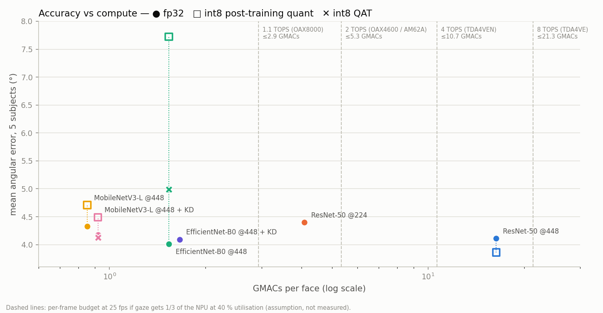

# L2CS-Net 輕量化：能不能放進車用 DMS 晶片？

> 實驗日期 2026-11-08，NCHC Nano4（H200），jobs 725329–725779。執行紀錄與所有臨時決定見 [`NOTES.md`](NOTES.md)。
> 產生方式：`scripts/make_light_report.py`（表格、圖）、`scripts/bench_light.py`（運算量／延遲／ONNX）、`scripts/eval_int8.py`（int8 PTQ）、`scripts/qat_finetune.py`（int8 QAT）。

## 結論
1. **現行模型太重**：L2CS ResNet-50 @448 每張臉 16.35 GMACs。Euro NCAP 要求 ≥25 Hz，在 1–2 TOPS 的入門 DMS 晶片（OAX8000、OAX4600、TI AM62A）上幾乎吃滿整顆 NPU，沒有空間跑人臉偵測、閉眼、手機偵測等其他模型。
2. **fp32 下，EfficientNet-B0 @448 用 1/11 的運算量（1.54 GMACs）就達到同樣精度**：15 fold 平均 4.09° vs ResNet-50 的 4.15°（成對差 −0.06°，p = 0.51，沒有顯著差異）。
3. **但車用 NPU 跑 int8，而 EfficientNet-B0 量化後精度崩掉**：直接 int8（PTQ）5 人平均 7.72°，量化感知微調（QAT）2 個 epoch 後仍有 4.99°（比 fp32 差約 1°）。
4. **能真正上車的建議組合：MobileNetV3-Large @448 + 知識蒸餾 + int8 QAT**，0.85 GMACs（ResNet-50 的 1/19），5 人平均 **4.13°**，和 ResNet-50 fp32 的 4.11° 持平。2 TOPS 晶片的理論上限約 1,170 fps，在「gaze 只分到 1/3 NPU、40% 利用率」的假設下也遠低於 5.3 GMACs 的每幀預算。
5. **降解析度（ResNet-50 @224）是最差的輕量化方式**：運算量只降 4 倍，誤差卻增加 0.29°。

## 為什麼要輕量化
- Euro NCAP SD 202 v1.2 要求影像至少 25 Hz；頭部轉動的短暫偏移只給約 0.48 秒（25 fps 下 12 幀），所以 gaze 模型必須每幀都跑。
- 市售 DMS 晶片的 NPU 峰值（int8）：OmniVision OAX8000 約 1.1 TOPS、OAX4600 2 TOPS、TI AM62A7-Q1 2 TOPS、NXP i.MX 8M Plus 2.3 TOPS、TI TDA4VEN 4 TOPS、TDA4VE 8 TOPS、TDA4VH 32 TOPS、Qualcomm SA8295P 約 60 TOPS（全晶片）。

## 實驗設計
- **候選**：骨幹網路換成 EfficientNet-B0、MobileNetV3-Large（torchvision ImageNet 權重，接同樣兩個 28-bin 頭）；輸入降到 224；知識蒸餾（老師 = 同一 fold 的 ResNet-50 `improved_e50/last.pkl`，T = 2，權重 1）；int8 量化（PyTorch FX、x86 後端、權重 per-channel）。
- **篩選**：5 個 fold（p00/p03/p07/p11/p14）× 20 epoch，improved 配方（cosine + 增強）。輕量骨幹 lr 1e-4（fold0 pilot 選出），ResNet-50 照原本 1e-5。在同樣 5 人上，ResNet-50 跑 20 epoch（4.11°）和 50 epoch（4.09°）幾乎一樣，所以 20 epoch 夠。
- **確認**：最好的 fp32 候選（EfficientNet-B0）補成 15 fold，和實驗 B 的 ResNet-50（15 fold、50 epoch）成對比較。
- **int8**：PTQ 用該 fold 訓練者的 256 張影像校正；QAT 從 `last.pkl` 開始微調 2 個 epoch（lr 1e-5，第 2 個 epoch 凍結 observer 與 BN 統計），轉成真正的 int8 模型後在 CPU 上評估。全部都不碰測試者的資料。
- **一律報告最後一個 epoch**（`last.pkl`），不用「看測試者挑的最佳 epoch」。

## 結果
### 篩選：5 人（p00/p03/p07/p11/p14）@ep20，誤差（度）

| 設定 | GMACs | 參數 (M) | Xeon 1 核 (ms) | 2 TOPS 理論上限 (fps) | fp32 平均 | int8 PTQ | int8 QAT |
|---|---|---|---|---|---|---|---|
| ResNet-50 @448 | 16.35 | 23.6 | 314 | 61 | 4.11 | 3.86 | — |
| ResNet-50 @224 | 4.09 | 23.6 | 93 | 245 | 4.40 | — | — |
| EfficientNet-B0 @448 | 1.54 | 4.1 | 75 | 651 | 4.01 | 7.72 | 4.99 |
| MobileNetV3-L @448 | 0.85 | 3.0 | 35 | 1174 | 4.33 | 4.71 | — |
| MobileNetV3-L @448 + KD | 0.85 | 3.0 | 35 | 1174 | 4.18 | 4.49 | 4.13 |
| EfficientNet-B0 @448 + KD | 1.54 | 4.1 | 75 | 651 | 4.09 | — | — |

### 逐人（fp32 @ep20）

| 設定 | p00 | p03 | p07 | p11 | p14 | 平均 |
|---|---|---|---|---|---|---|
| ResNet-50 @448 | 2.66 | 3.42 | 4.00 | 5.07 | 5.40 | 4.11 |
| ResNet-50 @224 | 2.26 | 4.34 | 4.14 | 5.14 | 6.10 | 4.40 |
| EfficientNet-B0 @448 | 3.04 | 2.62 | 3.70 | 5.39 | 5.31 | 4.01 |
| MobileNetV3-L @448 | 2.96 | 3.48 | 3.73 | 5.79 | 5.66 | 4.33 |
| MobileNetV3-L @448 + KD | 2.70 | 3.12 | 3.69 | 6.03 | 5.34 | 4.18 |
| EfficientNet-B0 @448 + KD | 2.75 | 2.78 | 3.76 | 5.60 | 5.57 | 4.09 |

### 15 fold（fp32，最後一個 epoch）

| 模型 | GMACs | 平均 ± 標準差 | 與 ResNet-50 差（成對） | 較好人數 | 配對 t 檢定 p |
|---|---|---|---|---|---|
| ResNet-50 @448（實驗 B，50 epoch） | 16.35 | 4.15 ± 1.17 | — | — | — |
| EfficientNet-B0 @448（20 epoch） | 1.54 | 4.09 ± 1.20 | -0.06 ± 0.34 | 9/15 | 0.51 |

圖中虛線是假設下的每幀運算預算：25 fps、gaze 分到 1/3 NPU、NPU 利用率 40%。實際利用率要上板量測，這只是粗估。

### 部署相關
- **ONNX**：7 種設定（含 ResNet-18、@224 版本）都能匯出 opset 17 並通過 `onnx.checker`。運算子：ResNet 只有 Conv/Relu/Add/Pool/Gemm；MobileNetV3 多了 HardSwish/HardSigmoid；EfficientNet 多了 Sigmoid/Mul（SiLU、SE）。上板前要確認 NPU 工具鏈支援這些。
- **延遲**：H200 上 batch 1 每個模型都是 2.4–3.8 ms，被 kernel 啟動開銷綁住，看不出差異，不列入比較。Xeon 8480+ 單核延遲：ResNet-50 @448 314 ms → MobileNetV3-L @448 35 ms（約 9 倍）。這只是 x86 CPU，不能代表車用 NPU。
- **大小**：int8 權重 ResNet-50 約 24 MB → MobileNetV3-L 約 3 MB。

## 限制
- 篩選只有 5 個人、每個設定只跑一次（seed 0）。逐人差異在 ±0.3–1°，所以 0.1–0.2° 的差距不顯著；只有 EfficientNet-B0 的 fp32 結果有 15 fold 確認。
- **建議的 MobileNetV3-L + KD + QAT 只在 5 人上驗證過**，要寫成正式結論，最好補完 15 fold（訓練 10 個 fold 約 4 GPU-h + QAT 約 2 GPU-h）。
- int8 是 PyTorch x86 後端的量化。實際 NPU（TIDL、SNPE/QNN、OmniVision 工具鏈）的量化方法不同，精度可能不一樣。
- NPU 的 fps 是由峰值 TOPS 推算的上限，沒有上板實測。人臉偵測（RetinaFace）的成本沒算進去。
- 輕量骨幹的 BN 是 train 模式、所有層都訓練、lr 1e-4，和原版 ResNet-50 的設定不同（原版凍結 conv1/bn1 與 layer1–4 的 BN 統計）。這是新模型必要的調整，不算改原配方。

## GPU 用量
輕量化部分合計約 **18.3 GPU-h**（pilot 1.3、篩選 9.0、EfficientNet-B0 補 15 fold 4.0、EfficientNet-B0 + KD 2.2、int8 PTQ 0.7、QAT 0.9、benchmark 0.1）。
