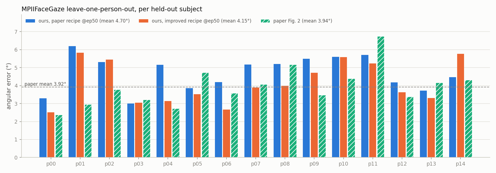
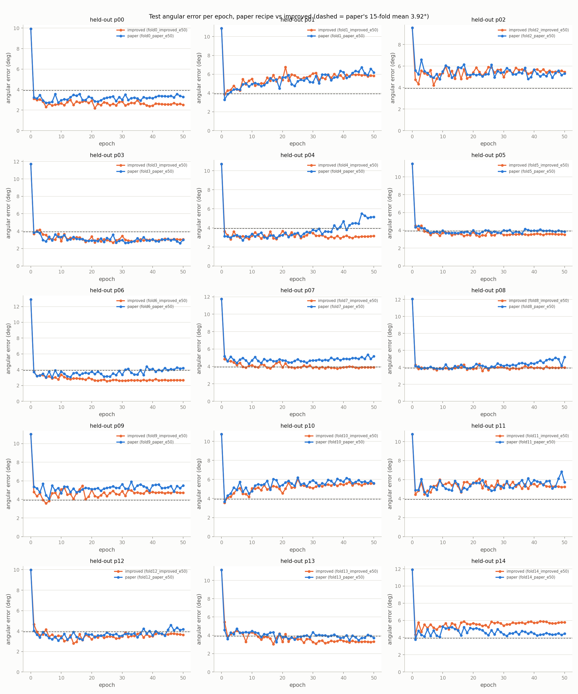
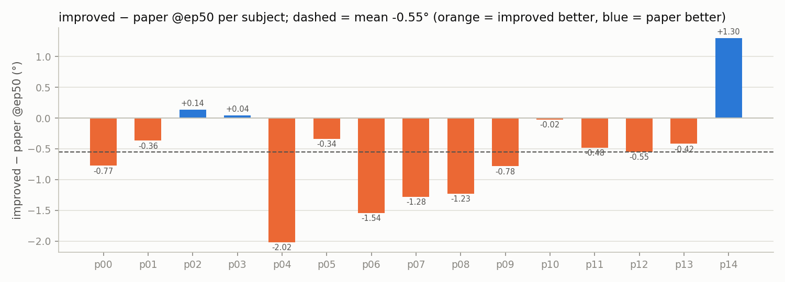

# L2CS-Net 在 MPIIFaceGaze 的 15-fold 完整實驗（Nano4 遠端）

> 產生方式：`scripts/make_report.py`（CSV、學習曲線）＋ `scripts/make_remote_charts.py`（表 1–3、逐人長條圖、成對差異圖）。
> 執行紀錄、所有臨時決定都在 [`NOTES.md`](NOTES.md)。執行日期 2026-11-07，節點 `25a-hgpn022`（job 720605、720606）。

## 結論（三句話）
1. 照論文配方（Adam 1e-5、batch 16、無增強）跑滿 15 fold × 50 epoch，**最後一個 epoch（@ep50）的 15 人平均是 4.70° ± 0.96°**，比論文的 3.92° 差 0.78°（+20%）；若用測試者本人挑最佳 epoch 是 3.53°，但這個數字偏樂觀，不能直接拿來比。
2. 差距主要來自**過擬合**：paper 配方的 15 人平均在 ep5 最低（4.05°，只比論文多 0.13°），之後一路上升到 ep50 的 4.70°；逐人最佳 epoch 的中位數只有 7。
3. **改良配方（cosine 1e-5→1e-7 + 輕量增強）在 50 epoch 下明顯勝出**：@ep50 平均 4.15°，15 人中 12 人比 paper 好，成對平均 −0.55°（配對 t 檢定 p = 0.017，Wilcoxon p = 0.015），而且曲線從 ep20 起就穩定、不會越訓練越差。

## 1. 硬體與設定
| 項目 | 值 |
|---|---|
| 機器 | NCHC Nano4（Slurm），compute node `25a-hgpn022`，**8× NVIDIA H200 141 GB**，driver 580.65.06 |
| 軟體 | Python 3.9 venv、**torch 2.8.0+cu128**、torchvision 0.23.0 |
| 精度 | `--amp` → **bf16** autocast（和本機一致） |
| 平行方式 | 一張 GPU 一個 fold，8 張同時跑（`scripts/run_folds.sh`），每個行程 4 個 DataLoader worker |
| 速度（paper） | 平均 **586 img/s**／行程，訓練 60 s／epoch，含 eval **1.00 min／epoch** |
| 速度（improved） | 平均 385 img/s／行程（增強在 CPU 上做，資料載入變慢），含 eval 1.52 min／epoch |
| 牆鐘 | A paper_e50：**1 h 53 min**；B improved_e50：**2 h 47 min** |
| GPU 小時 | A 15.1 + B 22.3 + 測試／smoke／失敗重送約 0.8 ≈ **38 GPU-h**（以整節點 8 卡計） |
| 未執行 | 實驗 C（消融），使用者要求控制 quota 用量而取消 |

## 2. 結果表

### 表 1：15 人逐人誤差（度）

| 測試者 | paper @ep50 | paper 最佳 (epoch) | improved @ep50 | improved 最佳 (epoch) | 論文 Fig. 2 |
|---|---|---|---|---|---|
| p00 | 3.29 | 2.71 (5) | 2.51 | 2.19 (21) | 2.38 |
| p01 | 6.19 | 3.27 (1) | 5.83 | 3.86 (1) | 2.96 |
| p02 | 5.31 | 4.78 (9) | 5.44 | 4.22 (7) | 3.78 |
| p03 | 3.00 | 2.61 (49) | 3.05 | 2.68 (27) | 3.21 |
| p04 | 5.16 | 2.68 (7) | 3.14 | 2.80 (3) | 2.72 |
| p05 | 3.86 | 3.63 (36) | 3.52 | 3.32 (22) | 4.73 |
| p06 | 4.20 | 3.00 (7) | 2.66 | 2.53 (25) | 3.58 |
| p07 | 5.17 | 4.30 (9) | 3.89 | 3.76 (38) | 4.07 |
| p08 | 5.21 | 3.82 (13) | 3.98 | 3.59 (23) | 5.17 |
| p09 | 5.49 | 4.07 (6) | 4.71 | 3.58 (5) | 3.47 |
| p10 | 5.60 | 3.67 (1) | 5.58 | 3.56 (1) | 4.39 |
| p11 | 5.71 | 4.31 (5) | 5.23 | 4.44 (1) | 6.74 |
| p12 | 4.18 | 3.08 (9) | 3.63 | 2.80 (14) | 3.39 |
| p13 | 3.72 | 3.26 (18) | 3.31 | 3.05 (17) | 4.17 |
| p14 | 4.47 | 3.78 (1) | 5.77 | 4.35 (1) | 4.32 |
| **平均 ± 標準差** | **4.70 ± 0.96** (n=15) | **3.53 ± 0.66** (n=15) | **4.15 ± 1.17** (n=15) | **3.38 ± 0.69** (n=15) | **3.94 ± 1.09** (n=15) |

### 表 2：和論文 15-fold 平均（3.92°）比較

| 數字 | 平均（度） | 與 3.92° 差 | 百分比 |
|---|---|---|---|
| 論文 L2CS-Net（MPIIFaceGaze） | 3.92 | — | — |
| 我們 paper @ep50（誠實數字） | 4.70 | +0.78 | +20.0% |
| 我們 paper 最佳 epoch（偏樂觀） | 3.53 | -0.39 | -9.9% |
| 我們 improved @ep50 | 4.15 | +0.23 | +5.9% |
| 我們 improved 最佳 epoch（偏樂觀） | 3.38 | -0.54 | -13.8% |

### 表 3：可重現性（@ep7，同配方）

| 測試者 | 配方 | 本機 run | 本機 @ep7 | 遠端 @ep7 | 差（遠端 − 本機） | 可比？ |
|---|---|---|---|---|---|---|
| p07 | paper | fold7_e10 | 5.04 | 4.95 | -0.08 | 是 |
| p00 | paper | fold0_e15 | 2.78 | 2.80 | +0.03 | 是 |
| p00 | improved | fold0_improved_e7 | 2.43 | 2.45 | +0.02 | 否（cosine 排程長度不同：本機 T=7，遠端 T=50） |
| p03 | improved | fold3_improved_e7 | 4.10 | 3.07 | -1.02 | 否（cosine 排程長度不同：本機 T=7，遠端 T=50） |
| p07 | improved | fold7_improved_e7 | 4.35 | 3.96 | -0.38 | 否（cosine 排程長度不同：本機 T=7，遠端 T=50） |
| p11 | improved | fold11_improved_e7 | 4.73 | 5.31 | +0.58 | 否（cosine 排程長度不同：本機 T=7，遠端 T=50） |
| p14 | improved | fold14_improved_e7 | 4.91 | 5.14 | +0.22 | 否（cosine 排程長度不同：本機 T=7，遠端 T=50） |
| p03 | paper | fold3_paper_e7 | 3.03 | 2.93 | -0.10 | 是 |
| p11 | paper | fold11_paper_e7 | 5.53 | 5.22 | -0.32 ⚠ | 是 |
| p14 | paper | fold14_paper_e7 | 4.75 | 4.82 | +0.07 | 是 |

> 表 1 的論文 Fig. 2 數字是從論文圖讀出的近似值，15 人平均 3.94°（論文文字寫 3.92°）。
> 「最佳 epoch」是用測試者本人的誤差挑出來的，等於偷看測試集，所以**偏樂觀**；@ep50 是不看測試集就能拿到的誠實數字。

### 補充：15 人平均隨 epoch 的變化（固定同一個 epoch 對所有人取平均）
| epoch | 1 | 5 | 10 | 20 | 30 | 40 | 50 | 最低（epoch） | 最後 5 個 epoch 平均 |
|---|---|---|---|---|---|---|---|---|---|
| paper | 4.18 | 4.05 | 4.28 | 4.36 | 4.37 | 4.61 | **4.70** | 4.05（5） | 4.69 |
| improved | 4.24 | 4.04 | 4.22 | 4.16 | 4.15 | 4.14 | **4.15** | 3.92（8） | 4.16 |

paper 配方在 lr 固定 1e-5 下持續過擬合；improved 配方的 lr 退火後收斂在 4.15° 附近。「最低（epoch）」那一欄同樣是看測試集挑的，只能當參考。

### 表 3 說明（可重現性）
- **可比的是 paper 配方**（lr 固定，ep7 時本機與遠端的訓練狀態相同）：5 組裡 4 組差異在 ±0.1° 內；計畫指定的檢查 **fold0 @ep7：遠端 2.80° vs 本機 2.78°（+0.03°）✔**。
- p11 差 −0.32°，略超過 0.3°；p11 本身在 ep3–10 之間逐 epoch 的標準差就有 0.58°（遠端）／0.67°（本機），而 `cudnn.benchmark=True` 和 DataLoader 多行程本來就不保證逐位元相同，所以判斷是正常的訓練隨機性，不是環境問題。
- **improved 那幾列不能比**：cosine 排程的長度跟著 `--epochs` 走，本機 7 epoch 的 run 到 ep7 時 lr 已退到 1e-7，遠端 50 epoch 的 run 到 ep7 時 lr 還在 9.5e-6，兩邊不是同一個訓練狀態。

## 3. 圖
**(a) 15 人逐人誤差：paper @ep50、improved @ep50、論文 Fig. 2**

**(b) 學習曲線**（make_report 產生；虛線為論文 3.92°）

全部 run 疊在一起：[`curves_all.png`](curves_all.png)

**(c) 成對差異 improved − paper @ep50（橙色 = improved 較好）**

## 4. 消融
沒有執行。實驗 C 是計畫裡的選做項目，跑之前使用者要求控制 quota，所以取消（約可省 12 GPU-h）。要補跑的指令在 `NOTES.md`。

## 5. 與論文不同之處
- **精度**：bf16 autocast（論文沒有提到混合精度）。
- **前處理**：自己移植的 GazeHub 正規化（`scripts/prep_mpiifacegaze.py`），不是論文作者的原始檔。
- **BatchNorm**：layer1–4 的 BN 固定在 eval 模式（`train_mpii.py` 預設，和本機一致）。
- **報告方式**：同時給 @ep50 與最佳 epoch；論文沒有說明 3.92° 是哪一種。
- **每個 fold 只跑一次**（seed 0），沒有重複取平均；`cudnn.benchmark=True`，不保證逐位元可重現。
- **資料載入**：每個 GPU 4 個 worker（計畫寫 6），原因是 compute node 採嚴格 overcommit 記憶體會計，worker 太多會讓 fork 失敗（詳見 NOTES.md）。不影響數值，只影響速度。
- **`face_detection` 套件**：沒有安裝，`train_mpii.py` 改成在沒有它時放一個 stub。訓練從不使用 RetinaFace，loss／模型／配方沒動。
- **論文 Fig. 2 逐人數字**是從圖上讀出來的近似值。
- 學習曲線圖 `curves_per_person.png` 的總標題和 p01 的小標題有點重疊，是 make_report 既有的版面，不影響數字。
